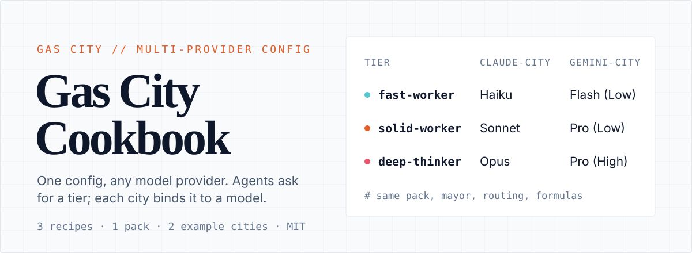
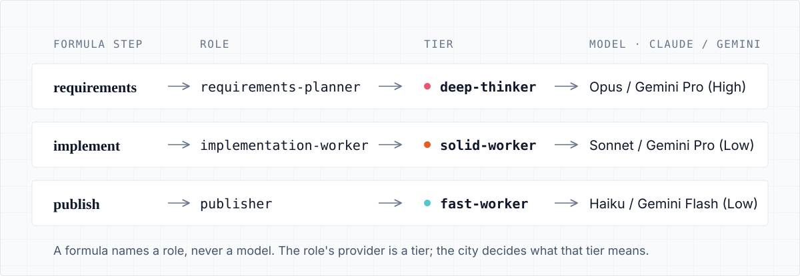
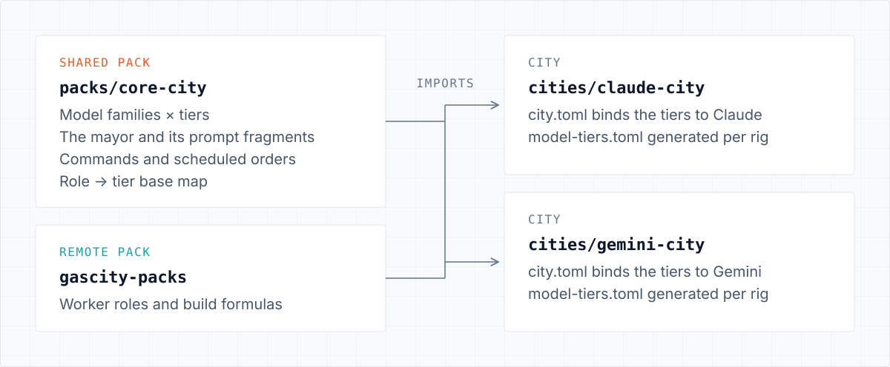

<p align="center">
  
</p>

# Gas City Cookbook

Patterns, a reusable config pack, and two copy-me example cities for running [Gas City](https://github.com/gastownhall/gascity), a Go toolkit for composing multi-agent coding workflows where all role behavior is user-supplied config.

**[Quick start](#quick-start)** · **[Recipes](#recipes)** · **[Setup guide](SETUP.md)** · **[Contributing](CONTRIBUTING.md)**

## The whole difference between two cities

Agents, routing and workflows only ever name three abstract tiers: `fast-worker`, `solid-worker`, `deep-thinker`. Each city binds those names to a model family, and that binding is the only thing that changes between a Claude deployment and a Gemini one.

```toml
# cities/claude-city/city.toml
[providers.fast-worker]
base = "claude-fast-worker"       # Haiku
[providers.solid-worker]
base = "claude-solid-worker"      # Sonnet
[providers.deep-thinker]
base = "claude-deep-thinker"      # Opus
```

```toml
# cities/gemini-city/city.toml
[providers.fast-worker]
base = "antigravity-fast-worker"  # Gemini 3.5 Flash (Low)
[providers.solid-worker]
base = "antigravity-solid-worker" # Gemini 3.1 Pro (Low)
[providers.deep-thinker]
base = "antigravity-deep-thinker" # Gemini 3.1 Pro (High)
```

The same pack, mayor, routing rules and formulas run on either provider unchanged. Model IDs live in one place, `packs/core-city/pack.toml`, so bumping a model is a single edit that every city in that family follows.

## How a build flows

<p align="center">
  
</p>

A formula such as `build-basic` routes each step to a role. The role's `provider` is a tier, and the city resolves the tier to a concrete model. Planning lands on the strong tier, implementation on the mid tier, and mechanical steps on the cheap tier, without the formula ever naming a model.

The role → tier map is one file, `packs/core-city/model-tiers.base.toml`. A custom command expands it across a city's rigs:

```bash
cd cities/<city> && gc cc gen-model-tiers > model-tiers.toml
```

## What's inside

<p align="center">
  
</p>

```
gascity-cookbook/
├── packs/core-city/               # the shareable pack: import this into any city
│   ├── pack.toml                  # provider families × tiers, imports, the mayor session
│   ├── model-tiers.base.toml      # role -> tier map (single source of truth)
│   ├── agents/mayor/              # coordinator: prompt.template.md + agent.toml
│   ├── template-fragments/        # reusable prompt chunks (routing, rhythm, coding rules)
│   ├── commands/                  # `gc cc <name>` custom CLI commands
│   ├── orders/                    # scheduled dispatch (hourly mayor sweep)
│   └── assets/scripts/            # helper scripts
├── cities/
│   ├── claude-city/               # example deployment on Claude
│   └── gemini-city/               # example deployment on Antigravity (Gemini)
├── recipes/                       # the patterns, explained
└── SETUP.md                       # instantiate a new city + manual prerequisites
```

## Quick start

You need the `gc` CLI on your PATH and the provider CLI you plan to use, installed and authenticated: `claude`, `agy` for Antigravity, or `kimi`. [SETUP.md](SETUP.md) has the full prerequisite list.

```bash
# 1. Pick a city to copy (claude-city or gemini-city)
cd cities/claude-city
gc import install                              # first on any fresh clone: fetches + pins remote packs
gc rig add /absolute/path/to/your/project      # registers the rig's real path

# 2. Validate, then bring it up
gc lint .
gc init . --preserve-existing                  # register + startup checks
gc start

# 3. Watch it
gc status
gc session peek cc.mayor                       # the always-on coordinator
```

To confirm a tier resolves to the model you expect:

```bash
gc config explain --json --provider deep-thinker | jq '.resolved.args'
```

## Recipes

| Recipe | What you get |
|---|---|
| [Multi-provider tiers](recipes/multi-provider-tiers.md) | The family-concrete + per-city-alias pattern that makes the setup portable across providers. |
| [The mayor](recipes/the-mayor.md) | A single always-on coordinator that triages work, dispatches to tiers, and monitors. |
| [Per-role model tiers](recipes/per-role-model-tiers.md) | The right model per workflow step, generated from one base map. |

## Vocabulary

| Piece | What it is |
|---|---|
| **Pack** | A reusable directory of config (`pack.toml` + definitions). `core-city/` is one. |
| **City** | A deployment: a `city.toml` (workspace provider + rigs) plus a `pack.toml` (its imports). The city is the root pack. |
| **Rig** | A project repo attached to a city, where work happens. |
| **Provider** | A coding-agent CLI + model (`claude`, `agy`, `kimi`), declared under `[providers.<name>]`. |
| **Agent / Role** | A worker or coordinator with a prompt. Formulas route work to roles by name. |
| **Formula** | A workflow (for example `build-basic`) whose steps route to roles. |

Config is composed at load time: a city's imports layer together (core-city plus the remote role and formula packs), then `city.toml` selects the workspace provider and rigs. No single file holds the final answer, so trace it with `gc config explain`.

## Good to know

- Gas City orchestrates existing CLIs and does not bundle them. Install and authenticate each provider yourself.
- Antigravity must be listed in `install_agent_hooks` to get its managed hooks. Claude and Kimi install theirs automatically.
- Kimi has a single model, so its fast, solid and deep concretes all point at the same base.
- Runtime state (`.gc/`, `.beads/`, `.agents/`) is never committed. Generated `model-tiers.toml` fragments are.

## Contributing and license

New recipes, provider families and fixes are welcome. See [CONTRIBUTING.md](CONTRIBUTING.md).

Built with [Gas City](https://github.com/gastownhall/gascity) and the public [gascity-packs](https://github.com/gastownhall/gascity-packs). Shared under the [MIT License](LICENSE).
