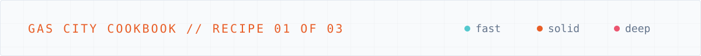

<p align="center">
  
</p>

# Recipe: multi-provider model tiers

**Goal:** run different cities on different model providers (Gemini/Antigravity, Claude, …)
without duplicating your agents, routing, or workflows. Abstract tier names are the stable
interface; the concrete model is a swappable per-city binding.

## The two layers

### 1. Family concretes (in the shared pack) — where model IDs live, once

`packs/core-city/pack.toml` defines a concrete provider per family × tier. This is the
single place a model ID appears.

```toml
# Antigravity (Gemini) family
[providers.antigravity-fast-worker]
base = "builtin:antigravity"
args = ["--model", "Gemini 3.5 Flash (Low)"]

[providers.antigravity-solid-worker]
base = "builtin:antigravity"
args = ["--model", "Gemini 3.1 Pro (Low)"]

[providers.antigravity-deep-thinker]
base = "builtin:antigravity"
args = ["--model", "Gemini 3.1 Pro (High)"]

# Claude family
[providers.claude-fast-worker]
base = "builtin:claude"
option_defaults = { model = "haiku" }

[providers.claude-solid-worker]
base = "builtin:claude"
option_defaults = { model = "sonnet" }

[providers.claude-deep-thinker]
base = "builtin:claude"
option_defaults = { model = "opus" }
```

### 2. Per-city aliases — bind the generic tier to a family (`base` chaining)

A provider's `base` can point at *another provider*, not just a `builtin:`. Each city binds
the three generic tier names. City-level providers override imported ones ("pack is base,
city wins").

```toml
# cities/gemini-city/city.toml
[providers.fast-worker]
base = "antigravity-fast-worker"
[providers.solid-worker]
base = "antigravity-solid-worker"
[providers.deep-thinker]
base = "antigravity-deep-thinker"
```

```toml
# cities/claude-city/city.toml
[providers.fast-worker]
base = "claude-fast-worker"
[providers.solid-worker]
base = "claude-solid-worker"
[providers.deep-thinker]
base = "claude-deep-thinker"
```

Now `fast-worker` / `solid-worker` / `deep-thinker` mean **Gemini Flash-Low / Pro-Low /
Pro-High** in gemini-city and **Haiku / Sonnet / Opus** in claude-city. Agents, routing,
and formulas reference only the generic names — identical across cities.

## Why this shape

- **One edit to change a model.** Bump `claude-deep-thinker` once; every Claude city follows.
- **A new city is a 3-line binding.** Add the aliases, done.
- **Family detection still works.** The `base` chain resolves to the builtin ancestor, so a
  Claude city gets Claude hooks and a Gemini city gets Antigravity hooks automatically.

## Gotchas

- **`command` / `path_check` are NOT variable-expanded.** Use a **bare command name on
  PATH** (`command = "kimi"`), never `$KIMI_PATH` or an absolute path — Gas City broadens
  PATH to include `~/.local/bin`, Homebrew, cargo, nvm/asdf, etc. Env-block *values*
  (secrets) *do* expand `$VAR`.
- **`install_agent_hooks`** — Claude auto-installs its hooks; **Antigravity must be listed**
  (`install_agent_hooks = ["antigravity"]` in the workspace) to get its managed
  prime/nudge/mail hooks. Kimi/opencode/etc. auto-install by default.

## Verify

```bash
cd cities/gemini-city
gc config explain --json --provider deep-thinker | jq '.resolved.args'   # → the Gemini Pro (High) model
```

---

[← README](../README.md) · Next: [The mayor →](the-mayor.md)
